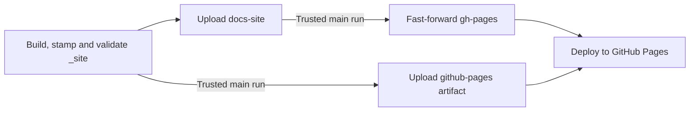

# Topics docs site

A static, dependency-free explainer of how Topics works. It is maintained here, deployed to GitHub Pages by `.github/workflows/docs.yml`, and must be updated in the same pull request as any change that affects behaviour, UI, architecture, data formats, commands or features (see `.claude/skills/documentation/SKILL.md`).

## Structure

```
docs/site/
├─ index.html       one page; sections are anchored and listed in the left nav
├─ style.css        all styling (light and dark via prefers-color-scheme)
├─ img/             screenshots used by the user guide
├─ check-links.py   relative link validator, also used by the workflow
└─ README.md        this file
```

All links and image paths are relative, so the site works from a Pages sub-path such as `https://<owner>.github.io/<repo>/`.

### Section layout

| Group | Sections (anchor ids) |
| --- | --- |
| Overview | At a glance (`at-a-glance`), Core principles (`principles`) |
| **Architecture** | System map (`system`), Crates & layers (`crates`), Data model & storage (`data`), The cloud boundary (`cloud`), Recoverable writes (`writes`) |
| **User guide** | `guide-start`, `guide-setup`, `guide-review`, `guide-topics`, `guide-today`, `guide-more` |
| **Product** | Feature breakdown (`features`), Milestones (`milestones`), Known limits (`limits`) |

When you add or rename a section, update the left `<nav class="toc">` too.

### Diagrams

Diagrams are Mermaid (`<pre class="mermaid">`), rendered in the browser from the jsDelivr CDN (`mermaid@11`). Mermaid is not vendored, to keep the repository small. If the CDN is unreachable or JavaScript is off, a note above the content explains that the diagrams need JavaScript and access to `cdn.jsdelivr.net`; the surrounding text describes each flow.

### Build stamp

The footer and nav contain `{{BUILD_SHA}}` and `{{BUILD_DATE}}`. The workflow replaces them in the published copy only; a local preview shows the literal placeholders. Do not remove them.

## Preview locally

```sh
python3 -m http.server -d docs/site 8000
# open http://localhost:8000/
```

Mermaid needs network access to the CDN for diagrams to render.

## Screenshots

Screenshots live in `img/` and are referenced as `img/<name>.png` with descriptive alt text.

- Capture only from **synthetic** notes, with an isolated absolute `TOPICS_APP_DATA_DIR`. Never use personal notes or follow the repository `notes` symlink (see `AGENTS.md`).
- Existing images were copied from `apps/desktop/evidence/` (Playwright captures such as `apps/desktop/evidence/design/*.png`, and native captures). Regenerate them with the desktop verification flow in `apps/desktop/README.md` and `docs/contributing.md`, then copy the result into `img/`.
- Take them at 1x, keep them under about 250 KB, and reuse the file name when replacing a picture so links stay valid.

## Checks

The workflow builds the site into `_site/` and fails if any relative `src`/`href` (including `../` escapes) points at a missing file or outside the site. Run the same check locally:

```sh
python3 docs/site/check-links.py docs/site
```

## Deployment

`.github/workflows/docs.yml` builds, stamps and validates `_site/` for matching pull requests and retains it as the `docs-site` artifact. Pushes to `main` that change `docs/**`, `README.md` or the workflow, and manual runs on `main`, also publish.



The branch job uses the built-in workflow token with Contents write permission. It creates `gh-pages` on the first run and adds ordinary commits to its existing history on later publishes. GitHub skips branch-source Pages builds for commits pushed with the workflow token. The deployment job uses Pages write permission and GitHub's OIDC token to deploy the same validated files via the official Pages artifact. Both jobs use the credentials GitHub Actions supplies automatically. [GitHub publishing source documentation](https://docs.github.com/en/pages/getting-started-with-github-pages/configuring-a-publishing-source-for-your-github-pages-site)

### One-time setup and verification

1. A repository maintainer opens [Settings → Pages](https://github.com/MacsDickinson/topics/settings/pages). Under **Build and deployment**, set **Source** to **GitHub Actions** to enable Pages. The repository already contains the workflow, so skip the suggested templates. If the `github-pages` environment has a deployment branch policy, ensure it allows `main`.
2. Once the workflow is on `main`, open **Actions → Docs → Run workflow** and select **main**, or use the run from a qualifying push to `main`.
3. Verify the build and relative-link check pass, `gh-pages` contains the generated files stamped with the run's short SHA and UTC build date, and the **deploy** job succeeds. Open the deployment URL shown by the job, confirm the footer stamp matches `gh-pages`, and check that the Appearance page and its images load from the project subpath.
